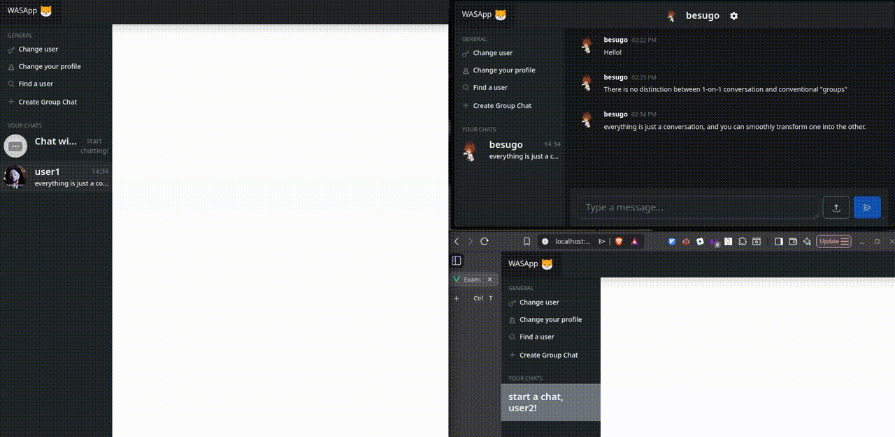

# WASApp (WASAtext)

My entry for the 2024/2025 WASA course project.

* WASApp is a chatting app, with GO backend, Vue frontend and thorough API documentation through OpenAPI standards, following the IBM-openapi ruleset.



# Important notice

This project is based on Fantastic Coffee (decaffeinated), a project structure focused on teaching Docker, API request routing and frontend/backend webdev.
This is NOT ment for deployment or a real production environment, and serves as a proof-of concept.

## Notes on the implementation

* Since the project did not have requirements or specifications on image storage :
  * *Every image is rendered from an URL.*
  * This gives users freedom to host their images on whatever sites they prefer, giving them no limits on their resolution and no server-side load.
  * If a user is not capable or does not want to go through the hassle of hosting their own, there is still an **easy-to-use** upload button to upload their images easily and quickly so that they can be used in the chats. (this is powered by an API, in this case the imgBB one.)
  * From a **privacy perspective**, if the user hosts their own images, it means they are free to shut them down, leaving no trace of them in the database, other than their URLs, which at that point result to nothing.
* *Multiple chats with the same person*
  * "Removing" this thing could've been a simple check in the backend, but it's a feature i would've liked to see for a long time in chatting apps. Being able to exchange things like vacation photos, projects information etc... without having to create a group with a single person (which in my opinion makes less sense and is less intuitive than just a normal chat) is really handy.
* *Groups and conversations are the same thing*
  * Again, i could've just made two tables, but at their core, a group is just a conversation with more than one person, so it would make little to no sense to treat them differently.
  * This also gives you the freedom to have, in combination with the previous feature, one-on-one chats that **don't force you** to the picture and name of the other person, without the step of creating a group.
    * This implies being also able to have "**private**" conversations with someone, e.g. you could rename the one-on-one conversation to some other random name and give it a random profile picture, and if someone snooped at your conversation history, they wouldn't know if that user even exists.
  * the "group" characteristic is thus **inferred** from just the number of people participating in a conversation.
* *You can create a chat with yourself*
  * Having multiple chats with yourself lets you organize stuff like storing ideas for different projects, TODOs etc...

## General structure

#### Fantastic coffee (decaffeinated)

This repository is built on the basic structure for [Web and Software Architecture](http://gamificationlab.uniroma1.it/en/wasa/) homework project.

"Fantastic coffee (decaffeinated)" is not suited for production environments.

###### Project structure

* `cmd/` contains all executables; Go programs here should only do "executable-stuff", like reading options from the CLI/env, etc.
  * `cmd/healthcheck` is an example of a daemon for checking the health of servers daemons; useful when the hypervisor is not providing HTTP readiness/liveness probes (e.g., Docker engine)
  * `cmd/webapi` contains an example of a web API server daemon
* `demo/` contains a demo config file
* `doc/` contains the documentation (usually, for APIs, this means an OpenAPI file)
* `service/` has all packages for implementing project-specific functionalities
  * `service/api` contains an example of an API server
  * `service/globaltime` contains a wrapper package for `time.Time` (useful in unit testing)
* `vendor/` is managed by Go, and contains a copy of all dependencies
* `webui/` is an example of a web frontend in Vue.js; it includes:
  * Bootstrap JavaScript framework
  * a customized version of "Bootstrap dashboard" template
  * feather icons as SVG
  * Go code for release embedding

Other project files include:

* `open-node.sh` starts a new (temporary) container using `node:20` image for safe and secure web frontend development (you don't want to use `node` in your system, do you?).

###### How to build

If you're not using the WebUI, or if you don't want to embed the WebUI into the final executable, then:

```shell
go build ./cmd/webapi/
```

If you're using the WebUI and you want to embed it into the final executable:

```shell
./open-node.sh
# (here you're inside the container)
yarn run build-embed
exit
# (outside the container)
go build -tags webui ./cmd/webapi/
```

###### How to run (in development mode)

You can launch the backend only using:

```shell
go run ./cmd/webapi/
```

If you want to launch the WebUI, open a new tab and launch:

```shell
./open-node.sh
# (here you're inside the container)
yarn run dev
```

###### How to build for production

```shell
./open-node.sh
# (here you're inside the container)
yarn run build-prod
```

###### Known issues

###### My build works when I use `yarn run dev`, however there is a Javascript crash in production/grading

Some errors in the code are somehow not shown in `vite` development mode. To preview the code that will be used in production/grading settings, use the following commands:

```shell
./open-node.sh
# (here you're inside the container)
yarn run build-prod
yarn run preview
```

###### License

See [LICENSE](LICENSE).
